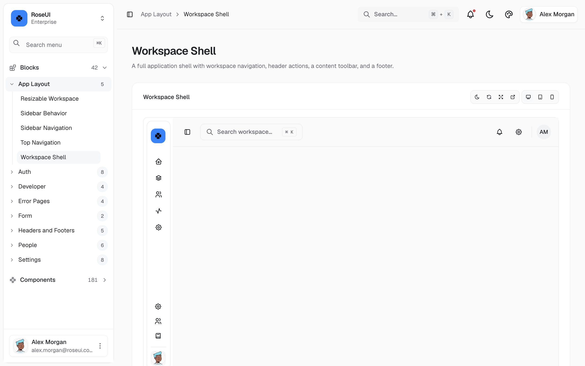

<div align="center">

# RoseUI

A free, open-source admin dashboard template and component gallery built with Next.js, React, Tailwind CSS, and shadcn/ui.

This project is based on [OrbynAdmin](https://github.com/masondevx/orbynadmin). It retains the original MIT license and copyright notice.


[Get started](#get-started) · [Project contents](#project-contents)



</div>

## Features

- Component examples for charts, forms, authentication, app layouts, data display, and interaction patterns.
- Block examples for authentication, developer tools, forms, headers and footers, people, settings, and app layouts.
- Light and dark themes, plus a theme customizer for accent color, corner radius, font, and sidebar style.
- Responsive application navigation with a collapsible sidebar, workspace switcher, and account menu.
- Charts built with Recharts and data tables built with TanStack Table.

## Get started

Use Node.js 20.9 or newer.

```bash
npm install
npm run dev
```

Open [http://localhost:3000](http://localhost:3000).

Run the production build and server with:

```bash
npm run build
npm run start
```

Run ESLint with:

```bash
npm run lint
```

### Preview pages

Every `ComponentPreview` declares a stable `previewId`. The preview route uses that ID:

```text
/preview/<previewId>
```

Preview loaders are generated from the page source. Run `npm run preview:generate` after adding or renaming a preview. The `dev` and `build` commands run the generator automatically. Do not edit `src/app/preview/preview-loaders.tsx` by hand.

Use the page path and a two-digit sequence for new IDs, such as `data-grid-01` or `app-layout-sidebar-behavior-01`. Keep IDs unique. The generator scans routes under `src/app/(app)`, rejects duplicate IDs, and maps each ID to its nearest owning `page.tsx`.

## Tech stack

- [Next.js 16](https://nextjs.org) with the App Router
- React 19 and TypeScript
- [Tailwind CSS 4](https://tailwindcss.com)
- [Radix UI](https://www.radix-ui.com) and shadcn/ui components
- [Tabler Icons](https://tabler.io/icons)
- [Recharts](https://recharts.org) and [TanStack Table](https://tanstack.com/table)
- [next-themes](https://github.com/pacocoursey/next-themes)

## Project contents

- **Blocks:** app layouts, authentication, developer tools, error pages, forms, headers and footers, onboarding, people, and settings.
- **Components:** charts, controls, data display, forms, feedback, media, navigation, text effects, and utility components.

Component pages live under `src/app/(app)/components/<name>/`. Block pages live under `src/app/(app)/blocks/<group>/<name>/`. The sidebar entries for both collections are defined in `src/data/nav.ts`.

### App layout examples

The App Layout group contains these examples:

- **Workspace Shell:** a complete workspace shell with navigation, header actions, a content toolbar, and a footer.
- **Sidebar Behavior:** sidebar placement, collapse modes, and visual variants.
- **Sidebar Navigation:** nested navigation and active states.
- **Top Navigation:** a header-first application layout.
- **Resizable Workspace:** a workspace canvas with a resizable activity panel.

App Layout previews show the workspace layout inside the application shell, including the workspace sidebar where the example calls for one. Sidebar Behavior and Sidebar Navigation focus on sidebar configuration and navigation states.

## Project structure

```text
src/
  app/
    (app)/       Application pages with the sidebar and header
      blocks/     Page blocks grouped by product area
      components/ Component examples and page-specific code
    (auth)/      Authentication layout
    preview/     Preview route and generated preview loaders
  components/
    composite/   Reusable composed components
    ui/          Reusable primitive UI components
  data/          Shared demo data and sidebar navigation
  lib/           Shared utilities and configuration
```

Most pages use local demo data. Replace the relevant files in `src/data/` and page-level datasets with your own data source.

## Credits

Demo avatars and product illustrations use [DiceBear](https://www.dicebear.com). Cryptocurrency icons use inline SVG brand marks. Names and figures in the examples are for demonstration.

## License

See [LICENSE](LICENSE). The original MIT license and copyright notice are retained.
